```mermaid
flowchart LR
    A([🏫 School]) -->|Groups · subjects · periods| B[Set up in minutes]
    B -->|Students from a spreadsheet| C[Teacher sheet]
    C -->|Grade saved| D([🎓 Student · 👪 Guardian])
    D -->|Sees it live, on any phone| E[Close the period]
    E --> F[📄 Report cards as PDF]

    style A fill:#1a1a1a,color:#FEB60D,stroke:#FEB60D
    style B fill:#1a1a1a,color:#DCDCDC,stroke:#333
    style C fill:#1a1a1a,color:#FEB60D,stroke:#FEB60D
    style D fill:#1a1a1a,color:#00D26A,stroke:#00D26A
    style E fill:#1a1a1a,color:#DCDCDC,stroke:#333
    style F fill:#1a1a1a,color:#00D26A,stroke:#00D26A
```

<div align="center">

<!-- ANIMATED HEADER -->


<!-- BADGES ROW -->
<p align="center">
  
  
  
  
  
</p>

<p align="center">
  
  
  
  
</p>

---

<!-- ANIMATED TYPING -->

[](https://git.io/typing-svg)

</div>

---

## 📌 Overview

**Education DT** is the education platform where grades reach students and families instantly. This repository is its **open commercial & technical showcase**: a small website that explains what the product does, who it is for, how it is priced, what it is built with and where it stands today.

> **It is not the product.** The product code is closed source and lives elsewhere. Here you can read, run and copy everything, because it is all commercial information.

_Design principles: **simple · fast · reliable** — light enough for rural and low-bandwidth schools, with child-data protection in mind from day one._

---

## 🔄 What the product does


| # | Step | Description |
|---|------|-------------|
| 1️⃣ | **Set up** | A school in minutes: grades, groups, subjects and periods, with students imported from a spreadsheet |
| 2️⃣ | **Grade** | From a fast teacher sheet |
| 3️⃣ | **See it live** | Students and guardians get the grade the moment it is saved, on any phone |
| 4️⃣ | **Close the period** | The school generates every report card as a PDF and follows its reports |

---

## 🎯 Who it is for

| Segment | Needs | When |
|---|---|---|
| 🏫 **Schools** (primary and secondary) | Grades per period, report cards, attendance, guardian communication | **First** |
| 🎓 **Universities** | Semesters, credits, course enrolment, certificates | Later |
| 📚 **Open courses and individuals** | Catalogue, direct enrolment, certificates | Later |

---

## 💰 Pricing model (indicative, COP)

A one-time setup fee plus a yearly subscription per **active student**.

| Plan | For | Indicative price |
|---|---|---|
| 🧪 **Pilot** | First 2–3 schools | 30–60 day trial, spreadsheet import included |
| 🏫 **Small school** | up to 300 students | ≈ COP 2,500–4,000 / student / year |
| 🏢 **Medium school** | 300–1,000 students | ≈ COP 2,000–3,200 / student / year |
| 🌐 **Large or multi-campus** | 1,000+ students | Quote |

> These are **starting figures to validate with pilot schools**, not a final price list. The setup fee is quoted per school.

---

## 🛠️ Technology

<table>
  <thead>
    <tr><th>Interface</th><th>Services</th><th>Computation</th><th>Cloud &amp; delivery</th></tr>
  </thead>
  <tbody>
    <tr><td>React + TypeScript</td><td>Node.js + TypeScript</td><td>C++</td><td>AWS</td></tr>
    <tr><td>Next.js</td><td>MongoDB</td><td>Python</td><td>Docker</td></tr>
    <tr><td>Tailwind CSS</td><td>PostgreSQL</td><td>PDF generation</td><td>CI/CD</td></tr>
    <tr><td>Zustand</td><td>Wompi payments</td><td>Analytics</td><td>Vercel</td></tr>
  </tbody>
</table>

---

## 🧭 Honest status

| Item | Status |
|---|---|
| Live grades, spreadsheet import, PDF report cards, platform subscription | 🟡 **Version 1 in progress** |
| Assignments, materials, messaging, tuition payments | 🔜 Roadmap |
| Universities and open courses | 🔜 Roadmap |
| Offline mode and mobile app | 🔜 Roadmap |
| Prices above | 🟡 **Indicative.** Validated with pilot schools before being fixed |
| Comparison with other platforms | The site lists them by name only. No third-party prices until they are verified at the source |

---

## 🚀 Run it locally

```bash
node >= 20
npm  >= 10
```

```bash
git clone https://github.com/NietoDeveloper/EducationPlatformDT.git
cd EducationPlatformDT
npm install
npm run dev
```

| Service | URL |
|---|---|
| 🌐 Web | <http://localhost:5174> |
| 🔌 API | <http://localhost:4200/api/health> |

> If the API is not running, the site falls back to the bundled content and says so in the hero.

**With Docker** (web on `8081`, API on `4200`):

```bash
npm run docker:up
```

### 🎮 Try the live-grade demo

The **"Pruébalo tú mismo"** section simulates the teacher and student views in your browser. It uses no server and no real data. It only illustrates the idea.

---

## 📁 Monorepo layout

```
EducationPlatformDT/
├── 📁 apps/
│   ├── web/                 # Vite + React + TS + Tailwind showcase site (Spanish)
│   └── api/                 # Express + TS API that serves the content (local)
├── 📁 packages/
│   └── content/             # Typed content and grade helpers shared by both
├── 📁 scripts/              # check-public guard
├── docker-compose.yml
├── SECURITY.md
└── LICENSE
```

| Script | What it does |
|---|---|
| `npm run dev` | Web + API in development |
| `npm run build` | Production build |
| `npm run typecheck` | TypeScript strict check |
| `npm test` | Unit and API tests |
| `npm run check:public` | Fails if a secret or private pointer sneaks in |

---

## 🛡️ Not deployed on purpose

This showcase is meant to be cloned and run locally. It deliberately contains **no product source code, no infrastructure layout, no secrets**. `npm run check:public` fails if anything that looks like a secret or a pointer to private infrastructure sneaks into the tree. See [SECURITY.md](SECURITY.md).

---

## 🎨 Design system

> Dark-first · Gold-accented precision · Readable on small screens

| Token | Value | Usage |
|-------|-------|-------|
| `gold` | `#FEB60D` | Accents, main buttons, highlights |
| `ink` | `#0A0A0A` | Cards and surfaces |
| `black` | `#000000` | Main background |
| `ok` | `#00D26A` | Success states |
| Typography | Inter · JetBrains Mono | Text · code |

---

## 📄 License

[MIT](LICENSE) for this repository. The Education DT product, name, logo and brand belong to Software DT.

---

<div align="center">


**Built by [Manuel Nieto](https://github.com/NietoDeveloper) · [softwaredt.com](https://softwaredt.com) · Software DT**

_© 2026 Software DT._

</div>


<div align="center">

<!-- ANIMATED HEADER -->


<!-- BADGES ROW -->
<p align="center">
  
  
  
  
  
</p>

<p align="center">
  
  
  
  
</p>

---

<!-- ANIMATED TYPING -->

[](https://git.io/typing-svg)

</div>

---

## 📌 Overview

**Education DT** is the education platform where grades reach students and families instantly. This repository is its **open commercial & technical showcase**: a small website that explains what the product does, who it is for, how it is priced, what it is built with and where it stands today.

> **It is not the product.** The product code is closed source and lives elsewhere. Here you can read, run and copy everything, because it is all commercial information.

_Design principles: **simple · fast · reliable** — light enough for rural and low-bandwidth schools, with child-data protection in mind from day one._

---

## 🔄 What the product does



| # | Step | Description |
|---|------|-------------|
| 1️⃣ | **Set up** | A school in minutes: grades, groups, subjects and periods, with students imported from a spreadsheet |
| 2️⃣ | **Grade** | From a fast teacher sheet |
| 3️⃣ | **See it live** | Students and guardians get the grade the moment it is saved, on any phone |
| 4️⃣ | **Close the period** | The school generates every report card as a PDF and follows its reports |

---

## 🎯 Who it is for

| Segment | Needs | When |
|---|---|---|
| 🏫 **Schools** (primary and secondary) | Grades per period, report cards, attendance, guardian communication | **First** |
| 🎓 **Universities** | Semesters, credits, course enrolment, certificates | Later |
| 📚 **Open courses and individuals** | Catalogue, direct enrolment, certificates | Later |

---

## 💰 Pricing model (indicative, COP)

A one-time setup fee plus a yearly subscription per **active student**.

| Plan | For | Indicative price |
|---|---|---|
| 🧪 **Pilot** | First 2–3 schools | 30–60 day trial, spreadsheet import included |
| 🏫 **Small school** | up to 300 students | ≈ COP 2,500–4,000 / student / year |
| 🏢 **Medium school** | 300–1,000 students | ≈ COP 2,000–3,200 / student / year |
| 🌐 **Large or multi-campus** | 1,000+ students | Quote |

> These are **starting figures to validate with pilot schools**, not a final price list. The setup fee is quoted per school.

---

## 🛠️ Technology

<table>
  <thead>
    <tr><th>Interface</th><th>Services</th><th>Computation</th><th>Cloud &amp; delivery</th></tr>
  </thead>
  <tbody>
    <tr><td>React + TypeScript</td><td>Node.js + TypeScript</td><td>C++</td><td>AWS</td></tr>
    <tr><td>Next.js</td><td>MongoDB</td><td>Python</td><td>Docker</td></tr>
    <tr><td>Tailwind CSS</td><td>PostgreSQL</td><td>PDF generation</td><td>CI/CD</td></tr>
    <tr><td>Zustand</td><td>Wompi payments</td><td>Analytics</td><td>Vercel</td></tr>
  </tbody>
</table>

---

## 🧭 Honest status

| Item | Status |
|---|---|
| Live grades, spreadsheet import, PDF report cards, platform subscription | 🟡 **Version 1 in progress** |
| Assignments, materials, messaging, tuition payments | 🔜 Roadmap |
| Universities and open courses | 🔜 Roadmap |
| Offline mode and mobile app | 🔜 Roadmap |
| Prices above | 🟡 **Indicative.** Validated with pilot schools before being fixed |
| Comparison with other platforms | The site lists them by name only. No third-party prices until they are verified at the source |

---

## 🚀 Run it locally

```bash
node >= 20
npm  >= 10
```

```bash
git clone https://github.com/NietoDeveloper/EducationPlatformDT.git
cd EducationPlatformDT
npm install
npm run dev
```

| Service | URL |
|---|---|
| 🌐 Web | <http://localhost:5174> |
| 🔌 API | <http://localhost:4200/api/health> |

> If the API is not running, the site falls back to the bundled content and says so in the hero.

**With Docker** (web on `8081`, API on `4200`):

```bash
npm run docker:up
```

### 🎮 Try the live-grade demo

The **"Pruébalo tú mismo"** section simulates the teacher and student views in your browser. It uses no server and no real data. It only illustrates the idea.

---

## 📁 Monorepo layout

```
EducationPlatformDT/
├── 📁 apps/
│   ├── web/                 # Vite + React + TS + Tailwind showcase site (Spanish)
│   └── api/                 # Express + TS API that serves the content (local)
├── 📁 packages/
│   └── content/             # Typed content and grade helpers shared by both
├── 📁 scripts/              # check-public guard
├── docker-compose.yml
├── SECURITY.md
└── LICENSE
```

| Script | What it does |
|---|---|
| `npm run dev` | Web + API in development |
| `npm run build` | Production build |
| `npm run typecheck` | TypeScript strict check |
| `npm test` | Unit and API tests |
| `npm run check:public` | Fails if a secret or private pointer sneaks in |

---

## 🛡️ Not deployed on purpose

This showcase is meant to be cloned and run locally. It deliberately contains **no product source code, no infrastructure layout, no secrets**. `npm run check:public` fails if anything that looks like a secret or a pointer to private infrastructure sneaks into the tree. See [SECURITY.md](SECURITY.md).

---

## 🎨 Design system

> Dark-first · Gold-accented precision · Readable on small screens

| Token | Value | Usage |
|-------|-------|-------|
| `gold` | `#FEB60D` | Accents, main buttons, highlights |
| `ink` | `#0A0A0A` | Cards and surfaces |
| `black` | `#000000` | Main background |
| `ok` | `#00D26A` | Success states |
| Typography | Inter · JetBrains Mono | Text · code |

---

## 📄 License

[MIT](LICENSE) for this repository. The Education DT product, name, logo and brand belong to Software DT.

---

<div align="center">


**Built by [Manuel Nieto](https://github.com/NietoDeveloper) · [softwaredt.com](https://softwaredt.com) · Software DT**

_© 2026 Software DT._

</div>
<div align="center">

<!-- ANIMATED HEADER -->


<!-- BADGES ROW -->
<p align="center">
  
  
  
  
  
</p>

<p align="center">
  
  
  
  
</p>

---

<!-- ANIMATED TYPING -->

[](https://git.io/typing-svg)

</div>

---

## 📌 Overview

**Education DT** is the education platform where grades reach students and families instantly. This repository is its **open commercial & technical showcase**: a small website that explains what the product does, who it is for, how it is priced, what it is built with and where it stands today.

> **It is not the product.** The product code is closed source and lives elsewhere. Here you can read, run and copy everything, because it is all commercial information.

_Design principles: **simple · fast · reliable** — light enough for rural and low-bandwidth schools, with child-data protection in mind from day one._

---

## 🔄 What the product does


| # | Step | Description |
|---|------|-------------|
| 1️⃣ | **Set up** | A school in minutes: grades, groups, subjects and periods, with students imported from a spreadsheet |
| 2️⃣ | **Grade** | From a fast teacher sheet |
| 3️⃣ | **See it live** | Students and guardians get the grade the moment it is saved, on any phone |
| 4️⃣ | **Close the period** | The school generates every report card as a PDF and follows its reports |

---

## 🎯 Who it is for

| Segment | Needs | When |
|---|---|---|
| 🏫 **Schools** (primary and secondary) | Grades per period, report cards, attendance, guardian communication | **First** |
| 🎓 **Universities** | Semesters, credits, course enrolment, certificates | Later |
| 📚 **Open courses and individuals** | Catalogue, direct enrolment, certificates | Later |

---

## 💰 Pricing model (indicative, COP)

A one-time setup fee plus a yearly subscription per **active student**.

| Plan | For | Indicative price |
|---|---|---|
| 🧪 **Pilot** | First 2–3 schools | 30–60 day trial, spreadsheet import included |
| 🏫 **Small school** | up to 300 students | ≈ COP 2,500–4,000 / student / year |
| 🏢 **Medium school** | 300–1,000 students | ≈ COP 2,000–3,200 / student / year |
| 🌐 **Large or multi-campus** | 1,000+ students | Quote |

> These are **starting figures to validate with pilot schools**, not a final price list. The setup fee is quoted per school.

---

## 🛠️ Technology

<table>
  <thead>
    <tr><th>Interface</th><th>Services</th><th>Computation</th><th>Cloud &amp; delivery</th></tr>
  </thead>
  <tbody>
    <tr><td>React + TypeScript</td><td>Node.js + TypeScript</td><td>C++</td><td>AWS</td></tr>
    <tr><td>Next.js</td><td>MongoDB</td><td>Python</td><td>Docker</td></tr>
    <tr><td>Tailwind CSS</td><td>PostgreSQL</td><td>PDF generation</td><td>CI/CD</td></tr>
    <tr><td>Zustand</td><td>Wompi payments</td><td>Analytics</td><td>Vercel</td></tr>
  </tbody>
</table>

---

## 🧭 Honest status

| Item | Status |
|---|---|
| Live grades, spreadsheet import, PDF report cards, platform subscription | 🟡 **Version 1 in progress** |
| Assignments, materials, messaging, tuition payments | 🔜 Roadmap |
| Universities and open courses | 🔜 Roadmap |
| Offline mode and mobile app | 🔜 Roadmap |
| Prices above | 🟡 **Indicative.** Validated with pilot schools before being fixed |
| Comparison with other platforms | The site lists them by name only. No third-party prices until they are verified at the source |

---

## 🚀 Run it locally

```bash
node >= 20
npm  >= 10
```

```bash
git clone https://github.com/NietoDeveloper/EducationPlatformDT.git
cd EducationPlatformDT
npm install
npm run dev
```

| Service | URL |
|---|---|
| 🌐 Web | <http://localhost:5174> |
| 🔌 API | <http://localhost:4200/api/health> |

> If the API is not running, the site falls back to the bundled content and says so in the hero.

**With Docker** (web on `8081`, API on `4200`):

```bash
npm run docker:up
```

### 🎮 Try the live-grade demo

The **"Pruébalo tú mismo"** section simulates the teacher and student views in your browser. It uses no server and no real data. It only illustrates the idea.

---

## 📁 Monorepo layout

```
EducationPlatformDT/
├── 📁 apps/
│   ├── web/                 # Vite + React + TS + Tailwind showcase site (Spanish)
│   └── api/                 # Express + TS API that serves the content (local)
├── 📁 packages/
│   └── content/             # Typed content and grade helpers shared by both
├── 📁 scripts/              # check-public guard
├── docker-compose.yml
├── SECURITY.md
└── LICENSE
```

| Script | What it does |
|---|---|
| `npm run dev` | Web + API in development |
| `npm run build` | Production build |
| `npm run typecheck` | TypeScript strict check |
| `npm test` | Unit and API tests |
| `npm run check:public` | Fails if a secret or private pointer sneaks in |

---

## 🛡️ Not deployed on purpose

This showcase is meant to be cloned and run locally. It deliberately contains **no product source code, no infrastructure layout, no secrets**. `npm run check:public` fails if anything that looks like a secret or a pointer to private infrastructure sneaks into the tree. See [SECURITY.md](SECURITY.md).

---

## 🎨 Design system

> Dark-first · Gold-accented precision · Readable on small screens

| Token | Value | Usage |
|-------|-------|-------|
| `gold` | `#FEB60D` | Accents, main buttons, highlights |
| `ink` | `#0A0A0A` | Cards and surfaces |
| `black` | `#000000` | Main background |
| `ok` | `#00D26A` | Success states |
| Typography | Inter · JetBrains Mono | Text · code |

---

## 📄 License

[MIT](LICENSE) for this repository. The EducatiT product, name, logo and brand belong to Software DT.

<div align="ce

<img src="https://capsule-render.vercel.app/api?type=waving&color=gradient&customColorList=0,2,2,5,30&height=120&section=footer&animation=fadeIn" width="
**Built by [Manuel Nieto](https://github.com/Neveloper) · [softwaredt.com